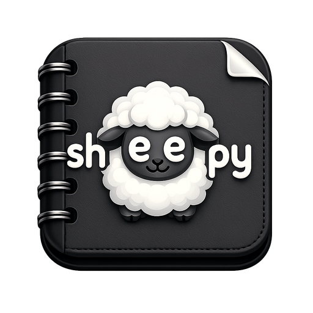

<p align="center">
  <a href="https://github.com/brunonlinespace/sheepy-pad">
    
  </a>
</p>

# Sheepy Pad

**Friendly. Fast. Focused.**

Sheepy Pad is a lightweight desktop editor and launcher for runnable Python and shell scripts. It combines straightforward source editing, syntax-aware presentation, script execution, environment controls, and a type-aware snippet Library without introducing a project database or private source-file format.

Current release: **0.4.2**

Repository: <https://github.com/brunonlinespace/sheepy-pad>

## What Sheepy Pad is

Sheepy Pad is designed for people who want to create, edit, check, and run individual scripts in one focused application. Scripts remain ordinary files on disk and can be opened directly from Sheepy Pad, from the command line, or by dragging supported files into the editor.

The supported document types are **Python (`.py`)**, **Python Windowed (`.pyw`)**, **Shell (`.sh`)**, **Bash (`.bash`)**, **Zsh (`.zsh`)**, and **Fish (`.fish`)**. Sheepy Pad deliberately does not become a general-purpose text editor, an integrated development environment, or a multi-file workspace manager.

<p align="center">


</p>

## Highlights

- Direct editing of ordinary `.py`, `.pyw`, `.sh`, `.bash`, `.zsh`, and `.fish` files.
- Compact **Start a Document** screen for choosing a script type, creating a document, or opening an existing file.
- Configurable **Default New Document**, including **Always Ask** for the document type.
- Syntax highlighting for Python, shell/Bash/Zsh, and Fish, with a dedicated Fish highlighter.
- Four persistent **Layout** arrangements for command controls, editor, and Find bar.
- Native **AppMenu** or compact **Menu Only** presentation with direct launch controls.
- Find, Find Next/Previous, Replace, Go to Line, Toggle Comment, Duplicate Line / Selection, and Delete Line.
- **View Only** mode for preventing accidental edits while retaining navigation and copying.
- **Launch**, **Launch in Terminal**, explicit **Launch as Admin in Terminal**, **Stop**, and **Force Stop**.
- **Run with Arguments**, shebang-aware interpreter resolution, per-type interpreter selection, working-directory control, and environment profiles.
- **Syntax / Lint Check** with optional host-installed Ruff and ShellCheck integration.
- **Script Library** with **156 built-in snippets**, filtered to the current document type and accompanied by guidance.
- Persistent favourites, user-defined snippets, and import/export of `.sheepysnippets` collections.
- Library placement as **Left Sidebar**, **Right Sidebar**, or **Floating Only**.
- Independent **Dark Editor** appearance and AppImage-only application-chrome theming.
- Safe script-file saving, external-change checks, file-management actions, and configurable drag-and-drop destination.
- Display of file path, cursor position, character count, encoding, Insert/Overwrite state, and executable status.
- Bundled documentation, a Keyboard Shortcuts dialog, GitHub and issue links, and hardened Fedora AppImage packaging.

## Interface

### Start a Document

Sheepy Pad opens on **Start a Document** when there is no active script. The compact form contains **Document type**, **Use this type as my default**, **Create Document**, and **Open Existing File...**.

**File → New** (`Ctrl+N`) creates the configured default script type, or asks for the type when **Always Ask** is selected. **File → New Type...** and **File → Default New Document...** provide the corresponding explicit controls.

The start screen and editor share the same document area. With no document open, Edit and Find commands are unavailable; an embedded Library sidebar is hidden until a document becomes active.

### AppMenu and command controls

The native application menu is organised as:

**File · Edit · View · Run · Help**

- **File** — create, open, save, select the document type, inspect properties, manage files, and open another window.
- **Edit** — clipboard, comment, line, search, replacement, and navigation actions.
- **View** — View Only, wrapping, line numbers, menu presentation, status bar, Library placement, layout, drag-and-drop, editor appearance, and display font.
- **Run** — executable permission, launch modes, arguments, checking, interpreter, working directory, environment profiles, Library, and process control.
- **Help** — documentation, keyboard shortcuts, GitHub, issue tracker, and About.

The toolbar supplies direct **Make/Remove Exec** and launch controls. For supervised script runs, the controls switch to the relevant **Stop** and **Force Stop** actions. **View → Menu Only** switches between the native AppMenu and compact menu buttons without removing the underlying commands.

## Editor layout

Sheepy Pad offers four persistent **View → Layout** arrangements:

1. **Inline — Top** — command controls and Find share the top toolbar.
2. **Inline — Bottom** — command controls and Find share the bottom toolbar.
3. **Split — Toolbar Up / Search Down** — toolbar at the top; Find below the editor.
4. **Split — Toolbar Down / Search Top** — toolbar at the bottom; Find above the editor.

In split layouts, the Find bar belongs to the editor column. A left/right Library sidebar therefore extends across the full document workspace rather than ending at the Find bar.

## Editing and search

The code editor provides syntax-coloured source text, optional line numbers and word wrap, configurable display font, clipboard operations, undo/redo, Toggle Comment, Duplicate Line / Selection, and Delete Line.

**Find** supports live highlighted results, match counts, optional case sensitivity, and next/previous navigation. **Replace** opens a separate modeless dialog with Replace and Replace All controls. **Go to Line** moves directly to a chosen source line.

Search is bounded to **10,000 matches**. Files larger than **25 MiB** are not opened, and oversized saves are rejected. The 0.4.2 editor also avoids excessive blank scrolling below the end of a document and keeps the line-number gutter above a visible horizontal scrollbar.

## Script execution

Sheepy Pad runs supported scripts using host interpreters; it does not bundle Python, Bash, Zsh, Fish, or a terminal emulator as substitutes for the host's tools.

- **Launch** starts the script as a managed process.
- **Launch in Terminal** opens the script through a supported host terminal emulator.
- **Launch as Admin in Terminal** explicitly requests a terminal-based `sudo` launch.
- **Run with Arguments...** accepts additional arguments, a terminal choice, an environment profile, and a working directory.
- **Stop** and **Force Stop** provide process-control actions for supervised launches. Administrator launches are intentionally detached and cannot be stopped through these controls.
- **Make Executable / Remove Executable** changes the script's executable permission and updates the displayed status.

Interpreter resolution follows the selected per-type override when one is configured, then a usable script shebang, then the file-type default. **Run → Select Interpreter...** shows the current resolution and permits an explicit interpreter choice.

The default working directory is the script's containing folder; **Run → Working Directory...** can select another directory. **Environment Profiles...** lets users maintain named sets of environment variables for script launches.

Before launching or checking a script, Sheepy Pad requires a saved backing file and checks for relevant changes on disk. Launching scripts executes their contents with the permissions of the chosen run mode; inspect scripts before running them, especially with administrator privileges.

## Syntax and lint checking

**Run → Syntax / Lint Check** checks the saved script using the available interpreter's syntax-check mode:

- Python source is compiled for syntax validation without executing the script body.
- Supported shell interpreters use their syntax-only checking mode (`-n`).
- Fish scripts use Fish's syntax-check mode.

When available on the host, **Ruff** adds Python lint results and **ShellCheck** adds checking for applicable `.sh` and `.bash` scripts. These external tools are optional; Sheepy Pad does not silently install them.

## Script Library

The **Script Library** is a snippet catalogue, not a template or package manager. Its **156 built-in entries** cover Python/Python Windowed, POSIX shell, Bash, Zsh, and Fish, and the Library filters what it shows to the active document type.

The catalogue includes **Favourites**, **All**, **Flow**, **Arguments**, **Environment**, **Files**, **Processes**, and **Custom**. Entries provide descriptions, insertion controls, and applicable Syntax/Lint guidance.

- **Run → Library → Library...** (`Ctrl+L`) opens or toggles the Library in its configured presentation.
- **View → Library** selects **Left Sidebar**, **Right Sidebar**, or **Floating Only**; Floating Only is the default.
- The embedded sidebar uses a compact category selector and a small **×**. Closing it hides the sidebar temporarily without changing its saved left/right position; `Ctrl+L` restores it.
- The floating Library uses tabs and provides custom-snippet management. Those management buttons are intentionally absent from the compact embedded sidebar.
- Favourites display a leading **★** and remain synchronized with **Run → Library → My Favourites**.
- Both presentations start on **Favourites** only when the active document type has at least one visible favourite; otherwise they start on **All**. Removing the last applicable favourite causes a selected Favourites view to fall back to All.
- User snippets can be added or removed and imported/exported as `.sheepysnippets` collections, with Merge or Replace handling on import.

The Library inserts source text into the current document. It does not execute snippets merely because they are selected or inserted.

## File handling and drag and drop

Sheepy Pad opens and saves ordinary supported script files, without storing their contents in a private document database.

**File → More Actions** provides Open in External Editor, Rename, Delete File, Duplicate File, and Open Containing Folder. **File → Properties** displays information about the active file. Duplicate File writes a separate copy; it does not replace the active editor with the duplicate.

**View → File Drag and Drop** provides two behaviors:

- **Opens on Active Window** — use the existing editor, subject to the usual unsaved-change checks.
- **Opens on New Window** — open accepted scripts in separate Sheepy Pad windows.

When several supported files are dropped in Active Window mode, the first uses the existing editor and the remainder open in additional windows. Unsupported file types are ignored or reported rather than treated as runnable scripts.

## File safety and external changes

Sheepy Pad treats source-file safety as part of the normal editing and execution workflow.

- Saving uses temporary-file writes and guarded replacement rather than direct in-place truncation.
- Before saving an existing file, Sheepy Pad checks whether its disk contents or identity changed and offers **Reload**, **Save As**, explicit **Overwrite**, or **Cancel**.
- A second file-state check can cancel saving when the file changes again before replacement.
- Save As, Duplicate, Rename, and Delete use destination or identity checks to reduce accidental replacement of unrelated files.
- When possible, opening and saving preserve the source encoding, byte-order mark, newline style, and existing file permissions.
- The editor rejects unsupported or apparently binary file contents and applies the **25 MiB** file-size limit.

External-change detection is performed at important file operations; it is not a claim that Sheepy Pad continuously monitors every file or can prevent another program from modifying a script.

## View Only

**View → View Only** protects the active document against accidental modification. It disables editing and replacement actions while preserving navigation, Find, selection, and copying.

View Only is an editor protection mode, not an operating-system permission change or a security sandbox. File and execution operations retain their own checks and confirmation paths.

## Appearance

**View → Dark Editor** independently changes the editor canvas, line-number gutter, syntax colours, selection, and search highlighting. It is enabled by default and is available independently of the application-chrome theme.

When running as an AppImage with the bundled theme files, **View → Dark Mode** switches between dark and light application chrome. AppImage launches also accept a one-launch `--appimage-theme dark`, `light`, or `system` choice. Ordinary source runs otherwise use the host Qt/desktop appearance.

Word Wrap, Line Numbers, Status Bar, Menu Only, Layout, Library placement, and display font are configurable. The status bar displays the active path, Insert/Overwrite state, executable-permission status, line/column/character information, and encoding.

## Useful keyboard shortcuts

| Command | Shortcut |
| --- | --- |
| New | `Ctrl+N` |
| New Window | `Ctrl+Shift+N` |
| Open | `Ctrl+O` |
| Save / Save As | `Ctrl+S` / `Ctrl+Shift+S` |
| Rename File | `F2` |
| Duplicate File | `Ctrl+Shift+D` |
| Open in External Editor | `Ctrl+Shift+E` |
| Open Containing Folder | `Ctrl+Shift+O` |
| Toggle Comment | `Ctrl+/` |
| Duplicate Line / Selection | `Ctrl+D` |
| Delete Line | `Ctrl+Shift+K` |
| Find / Replace | `Ctrl+F` / `Ctrl+H` |
| Find Next / Previous | `F3` / `Shift+F3` |
| Go to Line | `Ctrl+G` |
| Make / Remove Executable | `Ctrl+Shift+X` |
| Launch | `F5` |
| Launch in Terminal | `Ctrl+1` |
| Launch as Admin in Terminal | `Ctrl+Shift+1` |
| Run with Arguments | `Ctrl+2` |
| Syntax / Lint Check | `Ctrl+3` |
| Select Interpreter | `Ctrl+4` |
| Working Directory | `Ctrl+5` |
| Environment Profiles | `Ctrl+6` |
| Script Library | `Ctrl+L` |
| Stop / Force Stop | `Shift+F5` / `Ctrl+Shift+F5` |
| Documentation | `F1` |

The complete in-application reference is available under **Help → Keyboard Shortcuts**. Properties and Delete File deliberately have no keyboard shortcut.

## Running from source

Sheepy Pad requires Python 3 and **PyQt6 6.6 or later, below PyQt6 7**. Its source-portable layout contains:

```text
main.py
suite-pythoine-component.json
sheepy_pad/
```

From the extracted source root:

```bash
python3 -m venv sheepy_pad/.venv
source sheepy_pad/.venv/bin/activate
python -m pip install -r sheepy_pad/requirements.txt
python main.py
```

The source launcher can also be invoked through `sheepy_pad/portable/run-sheepy-pad.sh`. Other useful command-line forms include:

```bash
python main.py --version
python main.py script.py
python main.py first.py second.sh
```

When multiple supported paths are supplied, the first is opened in the initial window and subsequent files open in separate Sheepy Pad windows.

## Building the AppImage

The Fedora AppImage builder is included in the source tree:

```bash
./sheepy_pad/packaging/fedora/build-appimage.sh
```

The builder targets native **x86_64** and **aarch64** builds on **Fedora 43/44**. It is deliberately non-privileged, checks host prerequisites, runs source/release QA, creates an isolated Python build environment, freezes the application with PyInstaller, assembles and checks the AppDir, and smoke-tests the completed AppImage.

Expected outputs are written under `sheepy_pad/dist/`:

```text
Sheepy-Pad-0.4.2-<arch>.AppImage
Sheepy-Pad-0.4.2-<arch>.AppImage.sha256
Sheepy-Pad-0.4.2-<arch>.build-info.txt
Sheepy-Pad-0.4.2-<arch>.build-python-lock.txt
```

The builder rejects unexpected Qt PDF, Qt PrintSupport, and Qt WebEngine payloads and validates the packaged runtime under system, dark, and light theme modes. Formal release builds require an explicitly pinned `appimagetool` SHA-256.

Do not normally run the builder with `sudo` or as root. More detailed host preparation and release-build options are documented in `sheepy_pad/docs/BUILDING.md`.

## Validation

Run the canonical static/source QA entrypoint with:

```bash
bash sheepy_pad/qa/static-qa.sh
```

The retained checks cover application/version identity, file handling, runtime and script-library contracts, editor behavior, source/package structure, AppImage rules, and source-manifest integrity. The AppImage builder performs additional packaged-runtime and theme smoke checks.

## Configuration

Sheepy Pad stores per-user preferences outside the edited scripts.

Linux:

```text
~/.config/brunonlinespace/sheepy-pad/sheepy-pad.json
```

Windows:

```text
%APPDATA%\brunonlinespace\Sheepy Pad\sheepy-pad.json
```

Preferences include editor appearance, layout, Library placement, favourites and custom snippets, default new-document type, drag-and-drop behavior, interpreter overrides, working-directory choice, environment profiles, and run-dialog settings.

**Environment-profile values are stored as plain text in the preferences file. Do not put passwords, API tokens, or other secrets in them.** Script files remain ordinary external files rather than being embedded into preferences.

## Scope

Sheepy Pad is a **standalone runnable-script editor and launcher**. It deliberately supports the six script extensions `.py`, `.pyw`, `.sh`, `.bash`, `.zsh`, and `.fish` rather than accepting every text-based file type.

It does not provide project/workspace databases, document tabs, debugging, dependency management, a built-in terminal emulator, package installation, or a private script format. Script execution, checking, and optional linting depend on the appropriate host tools.

## License

Sheepy Pad is licensed under the **GNU General Public License v3.0 or later**.

See `sheepy_pad/LICENSE` for the complete license text.

## Links

- Sheepy Pad: <https://github.com/brunonlinespace/sheepy-pad>
- Issues: <https://github.com/brunonlinespace/sheepy-pad/issues>
- GitHub profile: <https://github.com/brunonlinespace/>

Copyright © 2026 Bruno Machado.
